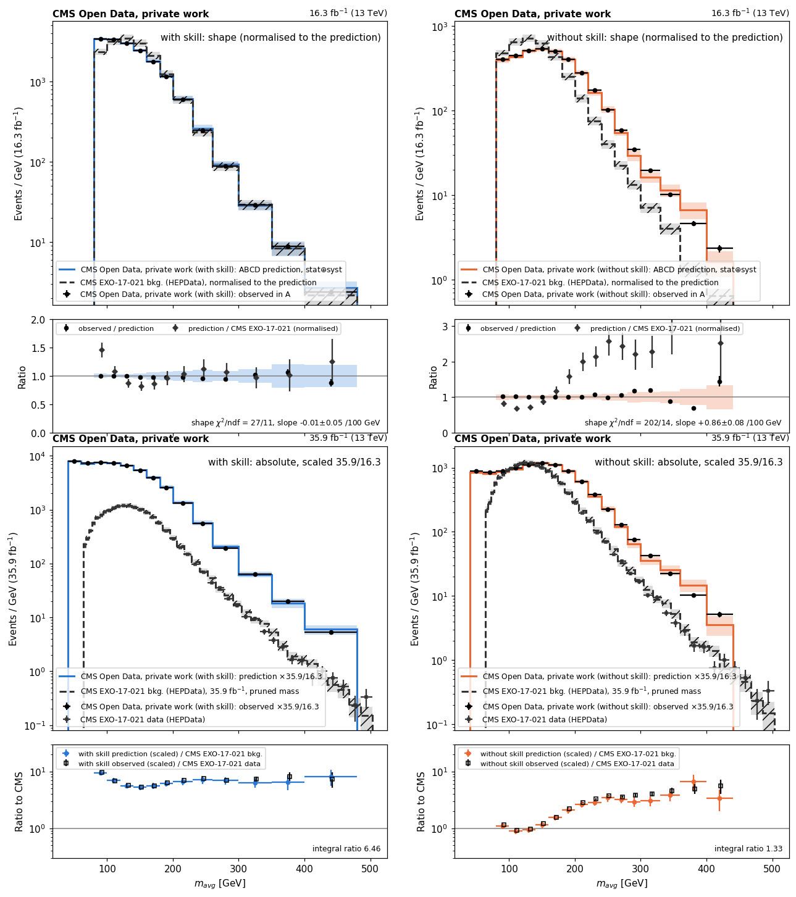
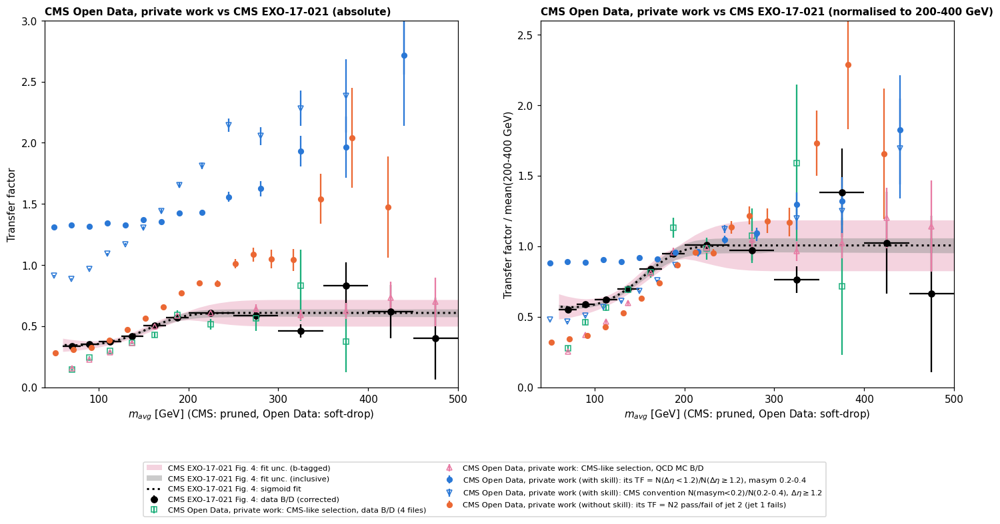
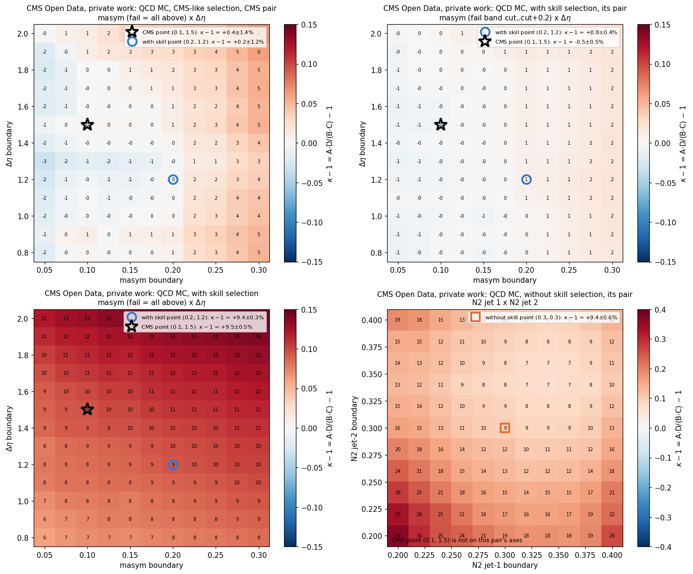
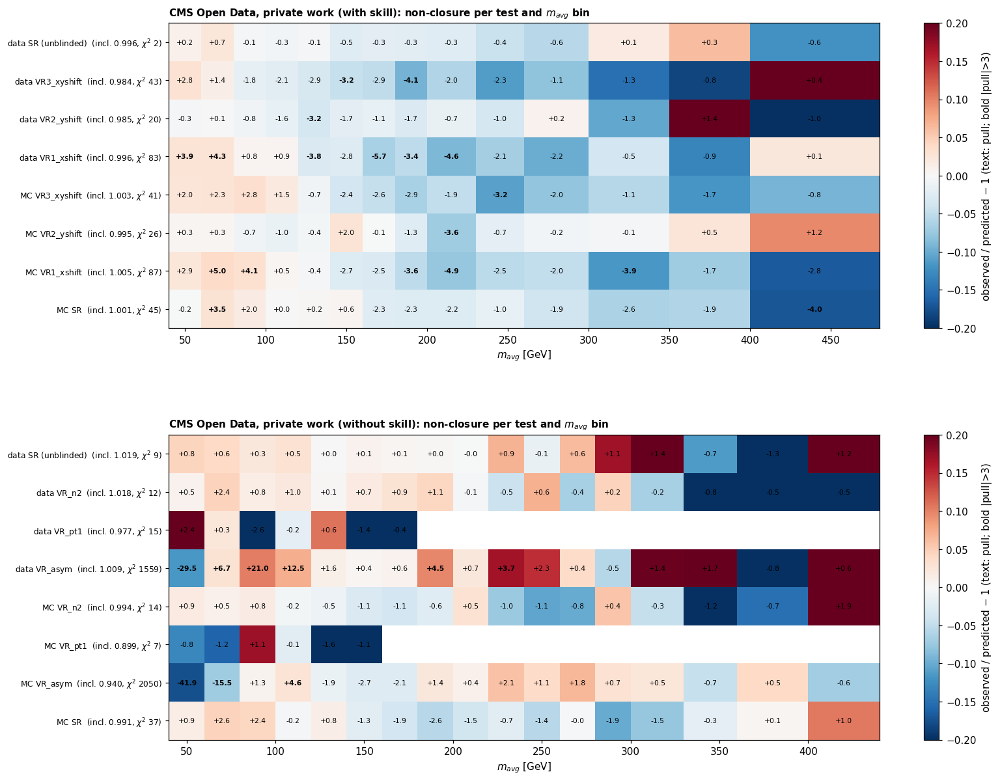
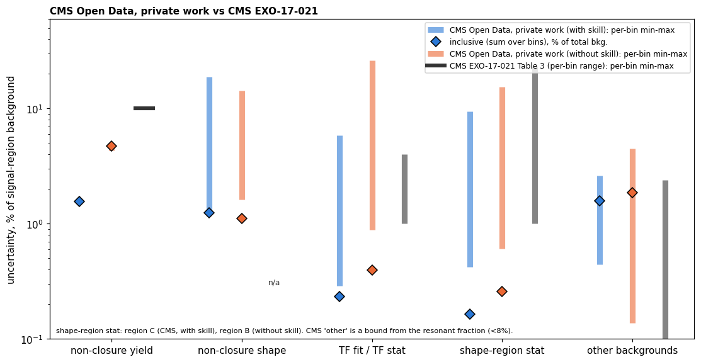

# Validation: ABCD multijet estimate for boosted paired dijets, with and without the `abcd` skill

**CMS Open Data, private work, not CMS results.** This validation accompanies
the `background-est` plugin (skill `abcd`). It tests whether the skill makes an
agent build a sound, CMS-like ABCD background estimate, and checks the result
against a published analysis.

## What was tested and why EXO-17-021 (boosted)

Task: estimate the QCD multijet background to a search for pair-produced
boosted resonances, each decaying to two quarks and reconstructed as one AK8
jet, in the m_avg = (m₁ + m₂)/2 spectrum of the 2016 G+H JetHT Open Data
(UL NanoAODv9, 16.3 fb⁻¹), with an ABCD (matrix) method.

The reference is the CMS search **EXO-17-021** (arXiv:1808.03124, PRD 98
(2018) 112014, HEPData ins1685989), boosted selection. It is the closest
published match: same final state, same observable, and an ABCD estimate with
a mass-dependent transfer factor (TF), a closure test and the same blinding
logic. Its ABCD axes are mass asymmetry × |Δη|, with τ21/τ32 as preselection.

## How it was run

- Two **blind** Sonnet students (agent `cms-analysis-coder`), same prompt
  ([PROMPT.md](PROMPT.md)), same model, **same reused skim**
  ([shared_inputs/INPUTS.md](shared_inputs/INPUTS.md)). They get no paper, ABCD
  variables, cuts or binning. **With skill**: the `background-est` plugin is
  loaded (workspace `ws_skill`). **Without skill**: it is not (`ws_noskill`).
  Scripts: [run_students.sh](run_students.sh).
- An **Opus** validator (agent `cms-results-validator`) compared both with
  EXO-17-021 ([CMS_COMPARISON_PROMPT.md](CMS_COMPARISON_PROMPT.md),
  [run_validator.sh](run_validator.sh)). Output:
  [cms-comparison/COMPARISON.md](cms-comparison/COMPARISON.md) and
  `comparison.json`.
- Follow-ups: the same with-skill student and the same validator were resumed
  to add validation plots ([STUDENT_PLOTS_PROMPT.md](STUDENT_PLOTS_PROMPT.md),
  [VALIDATOR_PLOTS_PROMPT.md](VALIDATOR_PLOTS_PROMPT.md),
  [run_followups.sh](run_followups.sh)). The new plots changed no verdict.
- The skill was iterated on earlier blind runs before this one.
- After the runs, the plot headers of the with-skill student were replaced by a
  plain "CMS Open Data, private work" label (`ws_skill/scripts/odlabel.py`) and
  its plotting scripts rerun; all numbers in `results.json` and `fits/` are
  unchanged (checked against a backup).

## Results

Verdicts are the validator's (thresholds in COMPARISON.md). Counts: 48/48 data
files, both students' regions A–D recounted exactly by the validator.

|                           | with skill                                                              | without skill                                                                         |
| ------------------------- | ----------------------------------------------------------------------- | ------------------------------------------------------------------------------------- |
| ABCD variables            | mass asymmetry × \|Δη\| (CMS pair); fail band 0.2–0.4                   | N2(j1) × N2(j2) (<0.30); pT1>550, pT2>300                                             |
| Variable choice           | κ ranking of 6 variables on QCD MC                                      | scan of N2 pairs; none close like masym × Δη                                          |
| TF form                   | quadratic in m_avg (F-test), applied to C                               | per-bin C/D, applied to B                                                             |
| Method validity           | **CONSISTENT**: B·C/D 470 261 ± 1 359 vs 471 753 obs; κ−1 = +0.8 ± 0.4% | **TENSION**: MC VR_asym 0.940, VR_pt1 0.90; 5% syst taken from a VR it then validates |
| MC closure (SR)           | 1.001, but 0.83 in the last bin (400–480 GeV)                           | 0.991, per bin 0.90–1.11                                                              |
| Pred vs obs (unblinded A) | **CONSISTENT**: χ² 2.2/14 (over-covered, p = 0.9998), max 0.66σ         | **CONSISTENT**: χ² 9.3/17, max 1.35σ, obs/pred 1.019                                  |
| Shape vs CMS (m_avg)      | **TENSION**: χ² 27.2/11 (p = 0.004), slope −0.01 ± 0.05 per 100 GeV     | **INCONSISTENT**: χ² 202/14, slope +0.86 ± 0.08 per 100 GeV                           |
| Level vs CMS (×35.9/16.3) | **INCONSISTENT**: 6.5×                                                  | **INCONSISTENT**: 1.33× (agreement by accident)                                       |
| Method choices vs CMS     | **CONSISTENT**: same pair, fitted smooth TF(m), unblind last            | **INCONSISTENT**: different axes, per-bin TF; unblind last                            |

Both students blinded A until the prediction was frozen. The level
disagreements are dominated by selection differences (see caveats), not by the
ABCD method.

Prediction vs CMS (normalised shape, and ratio):



Transfer factors vs CMS Fig. 4 (extracted from the PDF, not in HEPData):



Inclusive κ−1 over the boundary grids, and the per-test, per-bin non-closure
map:




Background uncertainty by source (CMS: arXiv Table 3):



## What the skill contributed, and what is still missing

The validator traces these to the skill: choosing masym × |Δη| by κ ranking
instead of N2 × N2; the fail-band-aware, fitted TF; shifted-boundary
validation regions; the non-closure rule (no systematic taken from the test it
covers); the full-covariance χ²; unblinding last.

Known remaining gaps (COMPARISON.md §7):

1. No helper applies a fitted TF(m) to C with its covariance.
2. No guidance on the per-bin shape term, nor an over-coverage check.
3. The effect of the fail-band width (κ 1.09 → 1.008) is not mentioned.
4. `tf_fit_ftest` fits polynomials only (no sigmoid, as in CMS Eq. 2).
5. `tf_flatness` assumes pass means y > ycut.
6. No recipe for signal contamination without signal MC.
7. Nothing on substructure as preselection versus ABCD axes, or on cross-checking
   against a published result (the validator found τ21/N2 are tagger-specific).

## Caveats

- **Open Data, not the CMS analysis.** 2016 G+H only (16.3 fb⁻¹, not 35.9),
  UL NanoAODv9, no signal MC.
- **PUPPI vs CHS:** the per-jet τ21<0.45 efficiency is 4.7× higher with UL
  PUPPI τ21 than with the CMS CHS τ21 (Fig. 2 overlay).
- **Soft-drop vs pruned mass:** the shapes differ below ~100 GeV (CMS-like
  B/D is 0.43–0.68× CMS there).
- **Unexplained factor ~1.9:** a CMS-like selection on this Open Data gives
  1.93× the CMS data yield (QCD MC 1.99× CMS). Not explained; the 6.5× and
  1.33× levels should be read relative to it.
- The CMS-like emulation uses 4/48 data files. Fig. 2 and Fig. 4 values are
  extracted from vector graphics (no uncertainties).
- **One run per arm.** Differences are not a statistical statement about the
  skill; they are an existence demonstration plus the validator's trace of
  each choice.

## Reproduce

```bash
voms-proxy-init -voms cms -valid 192:00
bash validation/abcd/run_students.sh     # creates ws_skill, ws_noskill from shared_inputs
bash validation/abcd/run_validator.sh    # audits reads, runs the Opus validator
bash validation/abcd/run_followups.sh    # follow-up plots (resumes both agents)
bash validation/abcd/cms-comparison/scripts/run_all.sh   # reruns the comparison numbers and plots
```

Each student's own steps are listed at the end of its `REPORT.md`; code is in
`ws_*/scripts/`. Skims and intermediates (parquet, npz, pkl) are not
committed; the skim is built by `shared_inputs/skim_payload.py` and lives on
EOS (`/store/user/$USER/...`). The comparison fetches the HEPData record
(`cms-comparison/ref/`, CC0).

Files: `ws_*/REPORT.md`, `SKILLS_USED.md`, `results.json`, `plots/`;
`cms-comparison/{COMPARISON.md,comparison.json,SKILLS_USED.md,plots/,scripts/}`.
