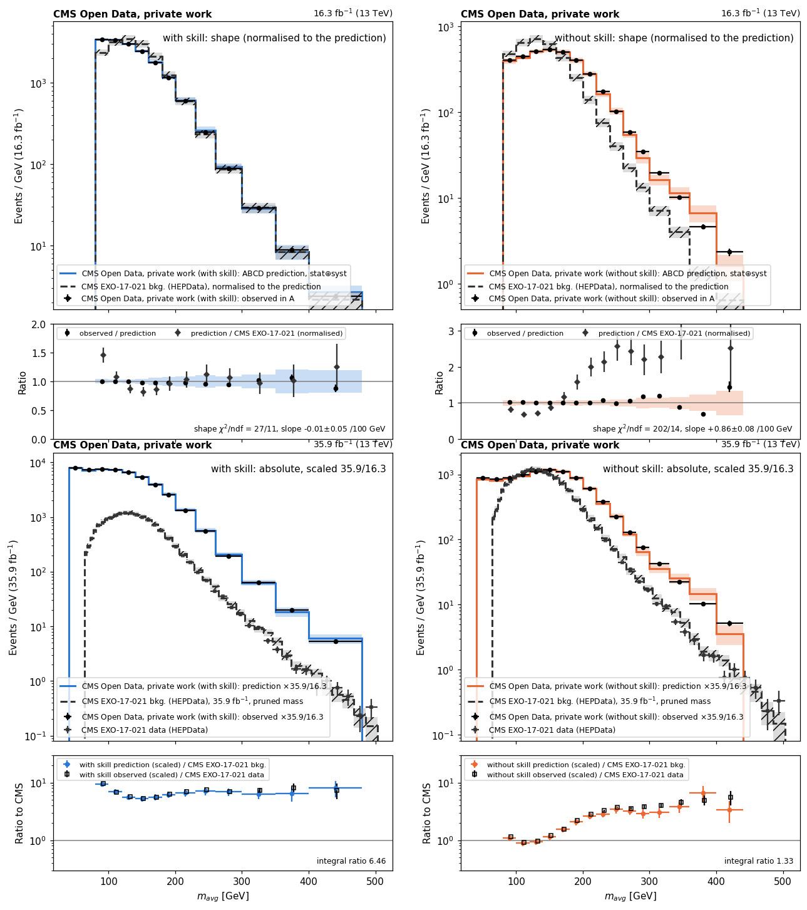
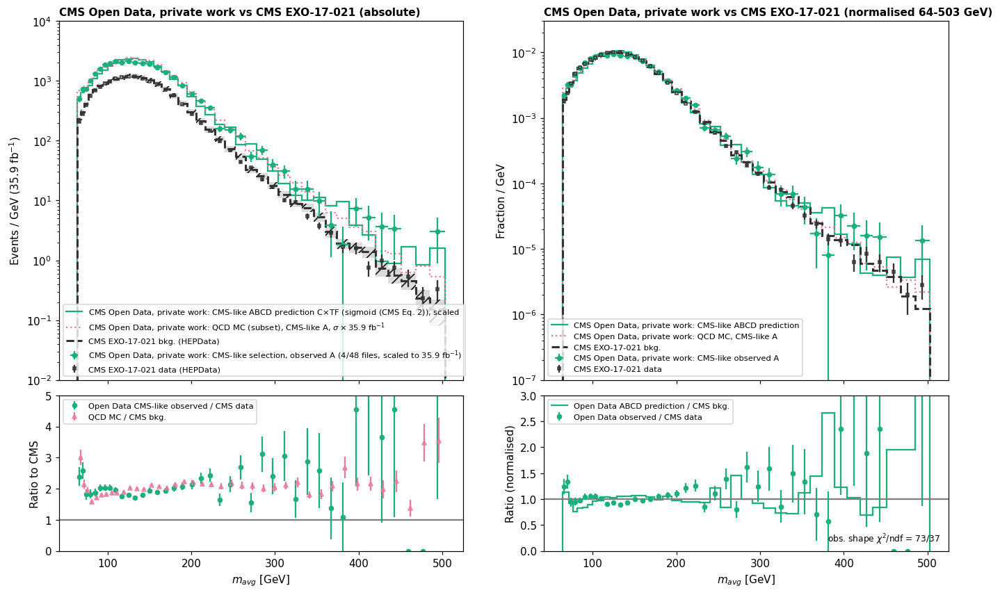
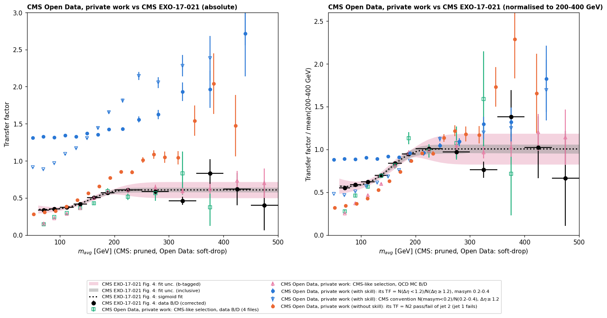
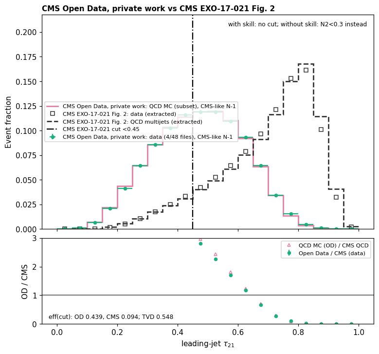
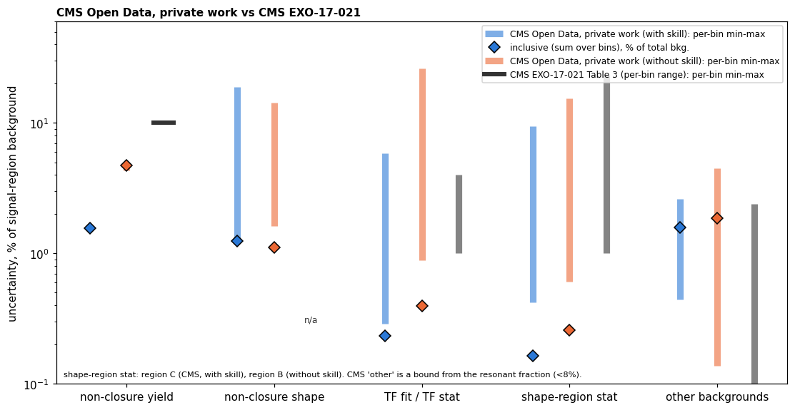
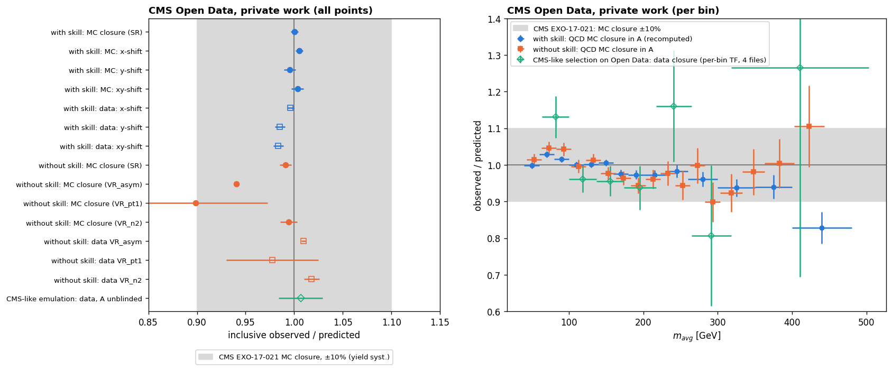
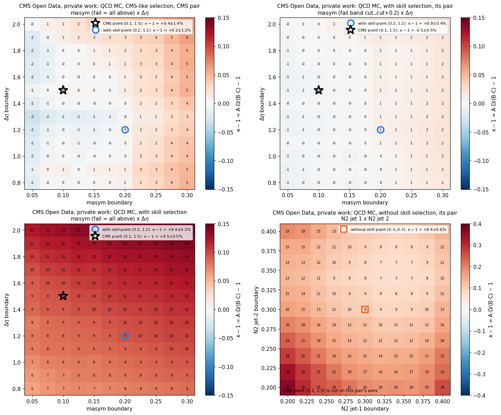
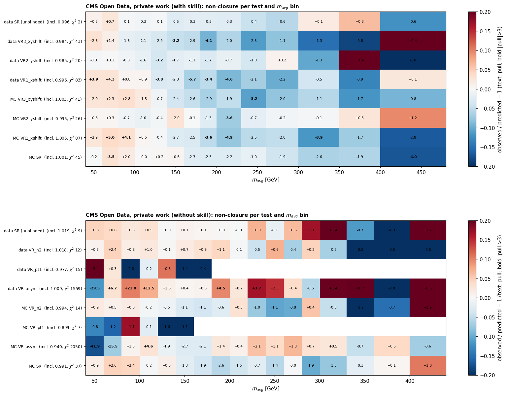

# ABCD multijet estimate in m_avg: two Open Data runs vs CMS EXO-17-021 (boosted search)

> **These are CMS Open Data studies (2016 G+H, UL NanoAODv9, 16.3 fb⁻¹) by two agent runs, private work. They are not CMS results.**
> "CMS" below means only the published EXO-17-021 (arXiv:1808.03124, PRD 98 (2018) 112014). Its HEPData record is ins1685989 (recid 85857); the m_avg spectra come from table 348181 (Fig. 5 left, inclusive boosted selection), read as JSON.
> The Fig. 2 and Fig. 4 values are **not in HEPData**. They were extracted from the vector graphics of the arXiv PDF and validated upstream (`ref/cms_extracted/`). They are used for the overlays in §8 and are labelled "extracted" wherever they appear.

**with skill** = `ws_skill` (had `background-est:abcd`). **without skill** = `ws_noskill` (did not).

**Verdict thresholds:**

| Verdict | Criterion |
|---|---|
| CONSISTENT | p ≥ 0.05 and a ratio slope below 2σ |
| TENSION | 0.0027 ≤ p < 0.05, or a slope of 2–3σ, or a clear trend |
| INCONSISTENT | p < 0.0027 (more than 3σ), or a slope above 3σ, or a result off by a known factor |
| NOT COMPARABLE | a difference that can neither be corrected nor bounded |

Items 1 and 6 are judged on the definitions. **The new plots changed no verdict.** They changed two explanations (§8.2, §8.4, §5).

## Summary

| Item | with skill | without skill |
|---|---|---|
| 1 Comparability | **TENSION**: same ABCD pair as CMS (masym × Δη), different cuts, no τ21/τ32 cuts. Data 48/48 files, exact recount | **INCONSISTENT**: N2 × N2 ABCD, no Δη cut, pT 550/300. Data 48/48 files, exact recount |
| 2 Method validity | **CONSISTENT**: B·C/D = 470 261 ± 1 359 vs obs 471 753. MC closure 1.001 but slopes (0.83 in the last bin) | **TENSION**: per-bin TF reproduced exactly. MC VR_asym 0.940 ± 0.002, MC VR_pt1 0.90 ± 0.07. The 5% syst is taken from a VR that is then used to validate |
| 3 Pred vs obs (unblinded A) | **CONSISTENT**: χ² 2.2/14, max 0.66σ, no excess. Over-covered (p = 0.9998). Stat-only χ² 49.7/14 | **CONSISTENT**: χ² 9.3/17 (10.4/17 with the 5% term correlated), max 1.35σ. Stat-only χ² 35.2/17 |
| 4 Shape vs CMS (80–480 / 80–440 GeV) | **TENSION**: χ² 27.2/11 (p = 0.004, 2.9σ), slope −0.01 ± 0.05 per 100 GeV | **INCONSISTENT**: χ² 202/14 (12σ), slope +0.86 ± 0.08 per 100 GeV |
| 5 Level / closure vs CMS | **INCONSISTENT** level (6.5× CMS after lumi scaling) / **CONSISTENT** closure (1.001 vs ±10%) | **INCONSISTENT** level (1.33× CMS, agreement by accident) / **CONSISTENT** closure (0.991, per-bin 0.90–1.11) |
| 6 Method choices vs CMS | **CONSISTENT**: same variables, fitted smooth TF(m), unblinded last | **INCONSISTENT**: different variables, per-bin TF. Unblinded last |
| 7 Skill effect | The variable choice, fitted TF, covariance χ² and non-closure rule all trace to the skill | — |

A CMS-like selection on the same Open Data (my emulation: 4/48 data files, 13 QCD MC files) gives **1.93× the CMS data yield**. QCD MC gives 1.99× the CMS background, so the emulated data and MC agree with each other. That factor is **not explained**.

Fig. 2 now shows why the emulation cannot simply be called "CMS on Open Data". The per-jet τ21<0.45 efficiency is **4.7× higher** with UL PUPPI τ21 (Open Data) than with the CMS CHS τ21. The 1.9× is therefore the net of large, compensating differences.

## Comparability matrix

| | CMS EXO-17-021 boosted | with skill | without skill |
|---|---|---|---|
| Data | all 2016, 35.9 fb⁻¹, legacy | 2016 G+H, 16.3 fb⁻¹, UL | same as with skill |
| Trigger | HT800/HT900 OR AK8PFJet360_TrimMass30 OR AK8PFHT(700/750)_TrimMass50, >98% | PFHT900 OR PFJet450 OR AK8PFJet450, 0.9957 above HT>1100 | same OR, 0.998 above pT1>550 |
| Offline | 2 AK8, pT>150, \|η\|<2.5, HT_AK8>900 | 2 AK8, pT>250, \|η\|<2.4, tight ID, HT_AK4>1100, lepton veto | pT1>550, pT2>300, \|η\|<2.5, tight ID, lepton veto, masym<0.2 |
| Substructure | τ21<0.45, τ32>0.57 on both jets (CHS) | none | N2<0.3 per jet, used as the ABCD axes (PUPPI) |
| ABCD axes | masym 0.1 × Δη 1.5 | masym 0.2 (fail band 0.2–0.4) × Δη 1.2 | N2(j1) 0.3 × N2(j2) 0.3 |
| TF | B/D = masym ratio at Δη>1.5, sigmoid in m, applied to C | Δη ratio in the masym fail band, quadratic (F-test), applied to C | per-bin C/D, applied to B |
| Mass, range | pruned, 60–450 GeV | soft-drop, 40–480 GeV | soft-drop, 40–440 GeV |
| Bkg syst | closure 10% (yield), TF fit 1–4%, C count 1–23%, resonant 10% | 1.6% yield + 1–20% per-bin shape, non-QCD 30% | 5.5–17% per bin (incl. a flat 5%), non-QCD 50% |

All comparisons are detector-level counts on both sides. The CMS total background includes resonant backgrounds below 8%. It is compared with each student's QCD + non-QCD total.

## 1. Comparability

**With skill:** Same ABCD pair as CMS. The boundaries differ, the τ21/τ32 cuts are missing (the main selection difference), and the trimmed-mass triggers are not used.

**Without skill:** The ABCD layout is not comparable. Substructure is used for both ABCD axes, where CMS uses it as a preselection. There is no Δη cut, and the pT thresholds are much higher.

**Both runs:** 48/48 data and 224/224 skim files were processed, with the golden JSON applied. My from-scratch recount of regions A–D on 4 raw skim files agrees **exactly** with both students' intermediates (`out/skim_check.json`).

## 2. Method validity on the students' own data

**With skill:**

- The raw inclusive B·C/D = 470 261 ± 1 359 against 471 753 observed (ratio 1.003).
- The prediction is 456 035 (QCD) + 17 767 (non-QCD) = 473 803 ± 10 641. That error lies between the uncorrelated (7 012) and fully correlated (21 733) sums, as it should.
- The per-bin MC closure rebuilt from `red/qcd.parquet` reproduces 1.0006 and χ² 45.3/14. It slopes at −2.8 ± 0.4% per 100 GeV, and is 0.83 ± 0.04 at 400–480 GeV.
- Data VRs at −2.9σ and −3.0σ set the 1.6% yield systematic.
- κ = 1.008 holds only with the masym fail band narrowed to 0.2–0.4.

**Without skill:**

- The per-bin prediction is reproduced to machine precision (sum 80 202). The inclusive B·C/D = 74 888 ± 315 is 7% lower (11% after non-QCD subtraction), because the N2 TF rises from 0.28 to 2.0 with m_avg.
- MC closure in the SR is 0.991, with per-bin values 0.90–1.11 (χ² 37/17).
- MC VR_asym closes at **0.940 ± 0.002** and MC VR_pt1 at **0.90 ± 0.07**.
- Data VR_asym is 1.009 ± 0.002 (4.4σ). It passes only with the 5% derived from that same region.
- Signal leakage into B and C (2ε(1−ε)) is not treated.

## 3. Prediction vs observed (unblinded A)

**With skill:** χ² 2.2/14 (I reproduce 2.26), max 0.66σ, no excess, as in EXO-17-021. The χ² is too good (p = 0.9998). With statistics only it is 49.7/14: +3.7σ at 60–80 GeV and −1.8 to −3.0σ at 140–260 GeV, both absorbed by the shape term.

**Without skill:** χ² 9.3/17, or 10.4/17 with the 5% term correlated. Max 1.35σ, obs/pred 1.019. The four lowest bins are 2–4.5% high.

## 4. Shape vs CMS — and plot 1, `plots/mavg_SR_vs_cms`

**Method:** The CMS Events/GeV densities are integrated onto the student bins from 80 GeV, and both spectra are normalised over the common range. The χ² has n−1 degrees of freedom and uses the published CMS errors.

**With skill:** The ratio to CMS is 0.82–1.45, with no slope (−0.011 ± 0.053 per 100 GeV). χ² = 27.2/11 (p = 0.004), driven by 80–100 GeV (+45%) and 140–180 GeV (0.82–0.87). With the 10% correlated CMS term removed, χ² = 117/11.

**Without skill:** The ratio runs from 0.67 to 5. The slope is +0.86 ± 0.08 per 100 GeV, and χ² = 202/14.

**New absolute panel:** after ×35.9/16.3, the per-bin predicted/CMS ratio is 5.3–9.4 (with skill) and 0.89–6.6 (without skill).

**Caveat:** the shape agreement of the with-skill run is partly a coincidence of looser cuts. Against the CMS-like emulation it gives χ² 75/11 (without skill: 269/14).

## 5. Level and closure vs CMS

Scaled by 35.9/16.3, the predicted background over the common range is **6.46× CMS** (with skill) and **1.33× CMS** (without skill). I split this with the 4 files, whose lumi fractions are 0.0806 and 0.0798 for the two runs:

- **Student / CMS-like emulation:** 3.39 (with skill) and 0.72 (without skill). This is the effect of the students' selections.
- **Emulation / CMS:** 1.88–1.93, **unexplained**.

Fig. 2 (§8.4) weakens the decomposition. The emulation's τ21 efficiency is 4.7× per jet above CMS's, so the "CMS-like" reference is itself far from CMS at the substructure level. The 3.39 and 0.72 should therefore be read as "relative to a CMS-like selection on PUPPI jets".

On closure, CMS has ±10%. With skill gives 1.0006 ± 0.004, within ±10% per bin except 400–480 GeV (0.83). Without skill gives 0.991, with per-bin values 0.90–1.11. Both are compatible with the CMS closure level.

## 6. Method choices vs CMS

**With skill** found the CMS pair by a κ ranking over 6 variables. It fits the Δη ratio where CMS fits the masym ratio; for A = B·C/D the two are equivalent. Both use a smooth fitted TF(m), and the unblinding order is correct.

**Without skill** used N2 × N2 with a per-bin TF; a pol2 fit of log TF gives χ² 320/14. Its blinding order is correct.

## 7. Skill effect (with skill vs without skill)

| Aspect | with skill | without skill | Traces to skill? |
|---|---|---|---|
| ABCD pair | masym × Δη (= CMS), κ ranking of 6 variables | N2 × N2, which the skill warns against | **yes**: pattern 1 (`SKILLS_USED.md`, `scripts/rank.py`) |
| TF form | quadratic by F-test (`tf_fit_ftest`) | per bin | **yes**: the flat/smooth/per-bin table |
| VRs | 3 MC + 3 data shifted-boundary | 3, two of them inverted-cut sidebands | **yes** |
| Non-closure | `nonclosure_syst` → 1.6% + shape term | flat 5% from the VR it then validates | **yes**: without skill breaks "never take a systematic from the test it covers" |
| Unblinded χ² | `chi2_cov`, full covariance | diagonal | **yes** |
| κ at the chosen point (§8.7) | +0.8 ± 0.4% | +9.4 ± 0.6% (inclusive) | **yes**: ranking by κ |

**What the skill got wrong or did not cover:**

1. No helper applies a fitted TF(m) to C with its covariance.
2. No guidance on the per-bin shape term, and no check for over-coverage (p = 0.9998).
3. Fail-band width is not mentioned (κ 1.09 → 1.008).
4. `tf_fit_ftest` fits polynomials only; the sigmoid is not available.
5. `tf_flatness` assumes pass means y > ycut.
6. No recipe for signal contamination without signal MC.
7. Nothing on substructure preselection (τ21/N2) versus ABCD axes, or on cross-checking against a published result.

## 8. New validation plots

### 8.1 `cmslike_od_vs_cms` — EXO-17-021-like selection on Open Data vs CMS

Scaled observed A is 2.28×10⁵ against 1.18×10⁵ CMS data: **1.93×**, flat in m_avg from 80 to 300 GeV. QCD MC is 1.99× the CMS background.

The emulated ABCD (sigmoid TF, as in CMS Eq. 2) closes at pred/obs 0.996; the TF fit has χ² 24.5/8. The normalised shape vs CMS data gives χ² 73/37 (p = 4×10⁻⁴) on the fine CMS bins, from 64–72 GeV and from scatter above 250 GeV. This tension was hidden by the coarser bins used before (4.7/11).

**Caveat:** only 4/48 data files are used, and the lumi fraction is taken from the students' A counts (1% agreement between the two runs).

### 8.2 `tf_vs_mavg_vs_cms` — transfer factors vs CMS Fig. 4 (extracted)

Normalised to 200–400 GeV, the CMS-like Open Data B/D follows the CMS sigmoid above about 125 GeV. Below 100 GeV it is only **0.43–0.68× CMS**, and it rises 3.6× from 60 to 225 GeV where CMS rises 1.8×. Soft-drop and pruned mass therefore differ at low mass, and the earlier claim that the mass definition does not change the shape is **withdrawn below about 100 GeV**.

The with-skill masym ratio (CMS convention) rises 2.0×, close to CMS. Its own Δη TF has a different definition and rises with m_avg instead of saturating. The without-skill N2 TF rises 3.0× and keeps rising.

**Caveat:** most CMS error bars sit inside the markers (hidden in the figure), so the χ² of 491/10 uses Open Data statistics only and is not a fair test.

### 8.3 `fig2_<var>` — N-1 distributions vs CMS Fig. 2 (extracted)

| Variable | Cut efficiency, Open Data | Cut efficiency, CMS | Ratio | TVD |
|---|---|---|---|---|
| masym <0.1 | 0.249 | 0.291 | 0.85 | 0.09 |
| Δη <1.5 | 0.679 | 0.711 | 0.95 | 0.03 |
| leading τ21 <0.45 | 0.439 | 0.094 | **4.7** | 0.55 |
| subleading τ21 <0.45 | 0.417 | 0.092 | **4.6** | 0.55 |
| τ32 >0.57 (lead/sub) | 0.93 / 0.92 | 0.99 / 0.99 | 0.94 | 0.24–0.26 |

The kinematic variables agree. τ21 does not: Open Data τ21 (PUPPI, UL) peaks at 0.45, CMS's (CHS) at 0.8. The product of the τ efficiency ratios (~19×) cannot be reconciled with the 1.9× yield ratio without a roughly 10× lower pre-substructure rate in the emulation (1.2×10⁶ against about 1.4×10⁷ implied by CMS). I cannot explain that.

The plots mark the CMS cut and each run's cut. Neither student cuts on τ21 or τ32. The without-skill N2<0.3 plays the role of a τ21 cut.

**Caveat:** this is extracted figure data (no uncertainties). The CMS QCD curve is simulation with the CMS selection.

### 8.4 `syst_breakdown_vs_cms` — background uncertainty by source

The values below are inclusive, as % of the SR background.

| Source | with skill | without skill | CMS (arXiv Table 3) |
|---|---|---|---|
| non-closure yield | 1.6 | 4.75 | 10 |
| non-closure shape | 1.25 (per bin 1.2–19) | 1.1 (per bin 1.6–14) | n/a |
| TF fit / stat | 0.23 (per bin 0.3–5.8) | 0.40 (per bin 0.9–26) | 1–4 |
| shape-region stat | 0.16 (0.4–9.5) | 0.26 (0.6–15) | 1–23 |
| other backgrounds | 1.6 | 1.85 | ≤ 2.4 (bound) |

The paper numbers this table 3; it is the table requested as "Table 6". Both students carry a smaller yield term than CMS's 10%, and similar per-bin shape terms at high mass.

The without-skill run varies the non-QCD subtraction in B, C and D by ±50%, but **not the non-QCD yield it adds in A**.

**Caveat:** the with-skill split into TF-fit and C-stat is rebuilt from its stat errors (refit check: 0.78–0.97 of the derived value).

### 8.5 `closure_summary` — relabelled

The CMS ±10% band is on both panels. The numbers are unchanged (§5).

### 8.6 `closure_heatmap` — κ−1 over boundary grids (QCD MC)

| Selection and pair | κ−1 at the marked point | Range over the grid |
|---|---|---|
| CMS-like selection, CMS pair, CMS point (0.1, 1.5) | +0.4 ± 1.4% | −3 to +7% |
| with-skill selection, its banded pair, (0.2, 1.2) | +0.8 ± 0.4% | −1 to +2% |
| with-skill selection, unbanded (all masym>cut) | +9.4% | 6–15% |
| without-skill N2 × N2 at (0.3, 0.3) | +9.4 ± 0.6% | 7–37% |

The fail band is what makes the masym × Δη pair close in the with-skill selection. The without-skill pair is correlated inclusively; its per-bin TF absorbs part of this, and the residual is its 0.90–1.11 per-bin closure.

**Caveat:** this is inclusive κ, not the per-bin estimator used by either student.

### 8.7 `nonclosure_heatmap` — per test and m_avg bin (colour obs/pred−1, text pull)

**With skill:** I recomputed all 7 tests from its reduced files, and they reproduce the stored ratios and χ² exactly. MC and data x-shifted VRs are coherently −3 to −6% at 160–300 GeV (|pull| up to 5.7), which sets its shape term. The unblinded SR has all |pull| < 0.7.

**Without skill:** MC and data VR_asym have pulls of −42 and −30 at 40–60 GeV, and +21 in data at 80–100 GeV. Its VRs are not like A. The unblinded SR has all |pull| < 1.4. The VR_pt1 bins above 180 GeV are empty.

## 9. Review of the with-skill student's new plots (`ws_skill/plots/`, REPORT "Plots")

Overall: **correct, and they support the analysis, with two caveats.**

**What checks out:**

- `closure_mc_perbin`, `nonclosure_map` and `closure_map_mc` agree with my independent recomputation: the 0.83 last bin, identical pulls, and κ−1 = +0.8% (2.1σ) at the chosen point.
- `closure_mc_variations` justifies the 0.2–0.4 fail band (+4.4% and χ² 850/14 otherwise) and the fitted TF (constant TF: χ² 609/14).
- `closure_map_data` honestly shows κ−1 of +0.7 to +4.1% (2–8.5σ) in shifted data regions, above the 1.6% yield systematic. This strengthens the caveat in §2, but the per-bin VRs that match the method (0.984–0.996) stay covered, so the verdict is unchanged.
- `substructure_dists` and `substructure_roc` are correct and show that τ21/N2 would have helped (QCD mistag 0.19–0.20 at 60% V efficiency). The student did not use them, unlike CMS.

**Problems:**

- REPORT item 1 says the MC closure is "−4% in the last bin". The plot shows **0.83 (−17%)**; −4.0 is the pull.
- REPORT item 6 calls `independence_ratio_vs_deta` "flat within 1–3%". The data rise from 1.087 to 1.101 over Δη 1.35–2.35 (about 2σ) and sit 2–3% below MC.
- On most plots, the bold mplhep "CMS" plus "Simulation Open Data, private work" header overlaps the luminosity text, and the axis labels overlap in `design_boundary_scan`. Use a plain "CMS Open Data, private work" label.

## What the students should do next

- **With skill:**
  - Replace the max-excess shape term with fitted nuisances (TF band, MC-closure slope).
  - Correct the "−4%" statement in REPORT.
  - Add τ21 or N2 as a preselection, using a PUPPI working point, not the CHS 0.45.
- **Without skill:**
  - Move N2 into the preselection and use masym × Δη for the ABCD axes.
  - Derive the systematic from tests that are independent of the VRs.
  - Vary the non-QCD yield in A.
  - Estimate signal contamination.
- **Both / reviewers:**
  - Resolve the τ21 discrepancy (PUPPI vs CHS) before using any "CMS-like" emulation as a proxy for CMS.
  - Measure the pre-substructure rate against the CMS normalisation.

## Files

| File | Contents |
|---|---|
| `comparison.json` | Verdicts per run (`runs["with skill"]`, `runs["without skill"]`), `plots`, `review_with_skill_plots`, `verdict_changes` |
| `out/*.json` | Intermediate results |
| `plots/` | `mavg_SR_vs_cms`, `cmslike_od_vs_cms`, `tf_vs_mavg_vs_cms`, `fig2_{masym,deta,tau21_lead,tau21_sub,tau32_lead,tau32_sub}`, `syst_breakdown_vs_cms`, `closure_summary`, `closure_heatmap`, `nonclosure_heatmap` (PNG and PDF) |
| `scripts/run_all.sh` | Reruns everything: `fetch_hepdata.sh`, `skim_check.py`, `recompute.py`, `closure_mc_a.py`, `compare_cms.py`, `cmslike.py`, `tests_perbin.py`, `plots_v2.py`, `write_json.py` |
| `ref/` | HEPData JSON (CC0); `cms_extracted/` (figure values, provided) |

Skim files (4 data, 13 QCD MC) are re-copied to `skimcache/` by `run_all.sh`; they are not kept.
