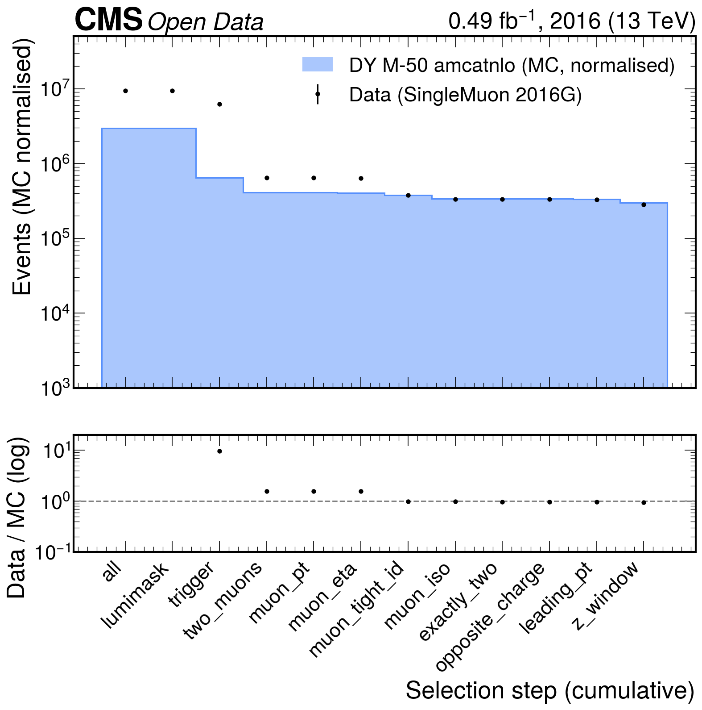

# Validation: NanoAOD skimming with bookkeeping on 2016 CMS Open Data

This validation exercises the `nanoaod-skimming` skill end to end. A
`cms-analysis-coder` agent (model: haiku) was given [PROMPT.md](PROMPT.md)
and carried out the task with the skill's scripts, supervised by a second
session that wrote the task and [check_results.py](check_results.py),
reviewed the outputs, and fixed the skill from the agent's feedback.

It is an **Open Data test of tools**. It is not a CMS result and makes no
physics claim. Plots are labelled "CMS Open Data".

## What it tests

The skim is only correct if its bookkeeping survives. The Z → μμ peak is the
end-to-end test: the DY prediction depends on the data luminosity from
`lumi.py`, on Σ genEventSumw from `sumw.py`, and on both skims keeping the
right events.

| Step                                                                                 | Script                             | Check                                                                              |
| ------------------------------------------------------------------------------------ | ---------------------------------- | ---------------------------------------------------------------------------------- |
| Skim 3 SingleMuon 2016G + 3 DY amcatnlo files, one job per file, golden JSON on data | `skim.py`                          | 2% to 3% of input size; counts ordered                                             |
| Merge with `hadd`                                                                    | `hadd`                             | merged entries = sum of per-file outputs                                           |
| MC normalisation                                                                     | `sumw.py`                          | Σ genEventSumw identical in originals and merged skim; Σ genWeight read = Runs sum |
| Luminosity                                                                           | `lumi.py`                          | full 2016 golden JSON gives 36.31 /fb; no lumi section missing from the CSV        |
| Z peak, 81 to 101 GeV                                                                | [zpeak.py](zpeak.py)               | data/MC within 0.8 to 1.2 with no scale factors                                    |
| Cutflow: skim steps from the Cutflow tree, then 8 analysis steps with N-1            | `cutflow.py`, [zpeak.py](zpeak.py) | per-file = merged; last skim step = merged entries; ends at the Z peak count       |

## Results

From [summary.json](summary.json):

| Quantity               | Value                                                        |
| ---------------------- | ------------------------------------------------------------ |
| Data processed         | 3 files, 9.46 M events, 2852 lumi sections, 490.4 /pb        |
| Data skim              | 645 k events, 152 MB of 7.5 GB (2.0%)                        |
| DY processed           | 3 files, 2.86 M events, Σ genEventSumw = 4.855e10            |
| DY skim                | 386 k events, 96 MB of 3.6 GB (2.7%), 15.8% negative weights |
| 2016 golden luminosity | 36.31 /fb                                                    |
| Z peak data / DY       | 281 527 / 297 829 ± 818 = 0.945                              |


The 5% deficit is the expected size of the muon ID, isolation and trigger
scale factors and the pileup reweighting that are deliberately not applied.
It is not a measurement of them.

### Cutflow (run 2)

Every skim carries a `Cutflow` tree (one entry per input file). `cutflow.py`
gives the same numbers on the three per-file skims and on the merged skim,
and its last step equals the merged Events entries. [zpeak.py](zpeak.py)
continues the cutflow on the merged skims. MC is in normalised events
(genWeight × σL / Σ genEventSumw); its `all` row equals σL = 2 980 196.

| Step             | Data      | Data N-1  | DY (norm.) | DY N-1  | Data/DY |
| ---------------- | --------- | --------- | ---------- | ------- | ------- |
| all              | 9 457 915 |           | 2 980 197  |         |         |
| lumimask         | 9 441 598 |           | 2 980 197  |         |         |
| trigger (skim)   | 6 245 012 | 952 534   | 645 441    | 428 532 | 9.68    |
| two_muons (skim) | 645 024   | 6 245 012 | 408 893    | 645 441 | 1.58    |
| muon_pt          | 645 024   | 281 730   | 408 893    | 297 955 | 1.58    |
| muon_eta         | 634 764   | 283 351   | 401 962    | 300 276 | 1.58    |
| muon_tight_id    | 375 867   | 290 315   | 378 594    | 300 333 | 0.993   |
| muon_iso         | 332 107   | 307 560   | 339 920    | 326 234 | 0.977   |
| exactly_two      | 332 039   | 281 543   | 339 912    | 297 831 | 0.977   |
| opposite_charge  | 331 896   | 281 549   | 339 900    | 297 831 | 0.976   |
| leading_pt       | 327 114   | 283 999   | 335 725    | 300 789 | 0.974   |
| z_window         | 281 527   | 327 114   | 297 829    | 335 725 | 0.945   |

Muon steps count events with at least two muons passing every muon cut so
far. The N-1 of a muon cut selects the muons without it and applies every
other cut. Pair steps use the two leading selected muons. The N-1 of a skim
step is within the two skim steps only: the events that failed are not in
the skim.



Data/DY is far above 1 until the tight ID, as expected: the SingleMuon data
also contain W, top and QCD events with non-prompt or fake muons, and the
MC is DY only. From the tight ID on, DY dominates and data/DY is about 0.95
to 0.99, the size of the scale factors and pileup weights not applied.

`check_results.py` passes 33 of 33 checks, 13 of them on the cutflow.

## Reproduce

```bash
bash validation/nanoaod-skimming/run_all.sh     # cmslpc; skims go to $SKIMDIR, about 2 to 10 min depending on EOS
python3 validation/nanoaod-skimming/check_results.py
```

Skims are not committed. `run_all.sh` writes them to
`$SKIMDIR=/uscms_data/d3/$USER/skims/nanoaod-skimming-validation`.

## What the agent found and what changed

From [SKILLS_USED.md](SKILLS_USED.md), fixed in the skill after the run:

- The gotcha on normalising by the event count quoted "a factor of about
  1.5" without saying which mistake gives it. Rewritten: σL/N ignoring
  `genWeight` is off by Σ|w|/Σw ≈ 1.46, `genWeight` \* σL/N by about 1.7e4.
- `skim.py` printed `SUMW_READ` with 6 significant digits. Now 10.
- The skill now says the LHE scale nominal is index 4 and the central PDF
  index 0, that `--lumi-json` needs a local file, and that `lumi.py` counts
  each lumi section once across files.
- Found by the supervisor in the agent's logs: one 2016G file has 1370 Events
  branches and the others 1380. `skim.py` now stops with a clear message when
  a later input lacks a kept branch, and the skill has a gotcha for it.

- Found when the supervisor reran `run_all.sh` on a busy login node: six
  parallel skims were killed by the kernel's out-of-memory handler and two
  XRootD reads timed out. `run_all.sh` now runs `MAX_JOBS` (default 2) at a
  time, and the skill has gotchas for both errors. The rerun reproduced
  every number in `summary.json`.
- `skim.py` summed float32 `genWeight` in float32, so `SUMW_READ` differed
  from the Runs sum by 2e-7. It now sums in float64 (difference 7e-9).
- A final review found that `skim.py` crashed when a counter (`nMuon`) was
  kept next to its collection, which includes the keep-everything default,
  and that a failed job left a readable partial output. Counters are now
  regenerated, and the output is written as `<output>.part` and renamed on
  success. The chain was rerun with the final scripts.

### Run 2: cutflow (cms 0.6.0)

`skim.py` now always writes a Cutflow tree, with named `--step` cuts, and
`cutflow.py` sums it. The agent reran the whole task with the cutflow added
to PROMPT.md. Its notes are the run 2 section of
[SKILLS_USED.md](SKILLS_USED.md). Fixed in the skill after the run:

- The Cutflow tree had no Σ genWeight², so MC uncertainties were impossible
  for skim steps. It now has `w2_*`, and `cutflow.py` prints `W err`.
- `cutflow.py`'s `cum` column was relative to the lumi-masked count, so the
  `all` row showed 1.0017. It is now relative to `n_all`.
- The skill did not say how to count object-level cuts, or their N-1, in
  events. It now gives the definitions used above, and the `all` row = σL
  check for MC.
- `cutflow.py` now says what `N_FILES` and `N_INPUT_FILES` count.

The chain was rerun with the final `skim.py`.

Not changed here: the `hist` skill's example label is "Preliminary", which
conflicts with the Open Data labelling rule. The agent could not load the
new skill with the Skill tool because the installed plugin, not the working
copy, was active. It read SKILL.md directly. Use `--plugin-dir plugins/cms`
as in PROMPT.md to test a working copy.
