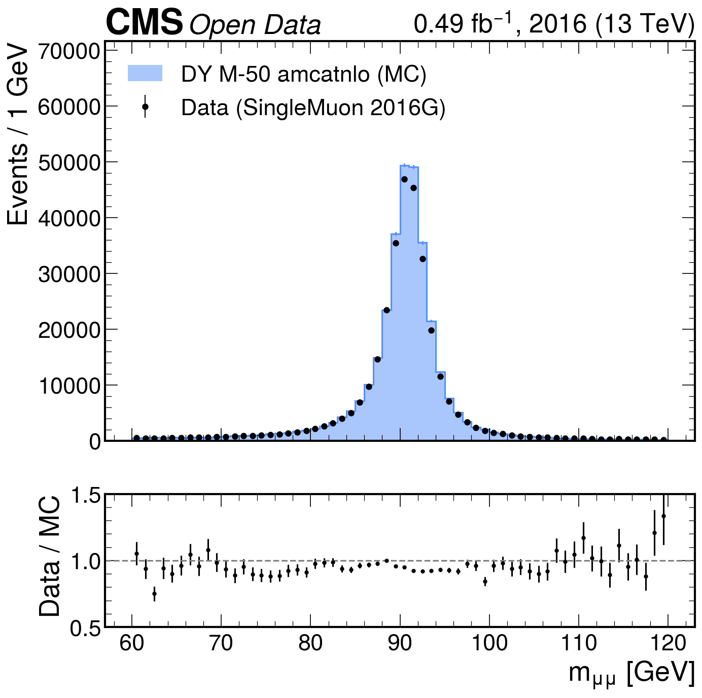

# Validation: NanoAOD skimming with bookkeeping on 2016 CMS Open Data

This validation exercises the `nanoaod-skimming` skill end to end. A
`cms-analysis-coder` agent (model: haiku) was given [PROMPT.md](PROMPT.md)
and carried out the task with the skill's scripts, supervised by a second
session that wrote the task and [check_results.py](check_results.py),
reviewed the outputs, and fixed the skill from the agent's feedback.

It is an **Open Data test of tools**. It is not a CMS result and makes no
physics claim. Plots are labelled "CMS Open Data".

## What it tests

The skim is only correct if its bookkeeping survives. The Z → μμ peak is the
end-to-end test: the DY prediction depends on the data luminosity from
`lumi.py`, on Σ genEventSumw from `sumw.py`, and on both skims keeping the
right events.

| Step                                                                                 | Script               | Check                                                                              |
| ------------------------------------------------------------------------------------ | -------------------- | ---------------------------------------------------------------------------------- |
| Skim 3 SingleMuon 2016G + 3 DY amcatnlo files, one job per file, golden JSON on data | `skim.py`            | 2% to 3% of input size; counts ordered                                             |
| Merge with `hadd`                                                                    | `hadd`               | merged entries = sum of per-file outputs                                           |
| MC normalisation                                                                     | `sumw.py`            | Σ genEventSumw identical in originals and merged skim; Σ genWeight read = Runs sum |
| Luminosity                                                                           | `lumi.py`            | full 2016 golden JSON gives 36.31 /fb; no lumi section missing from the CSV        |
| Z peak, 81 to 101 GeV                                                                | [zpeak.py](zpeak.py) | data/MC within 0.8 to 1.2 with no scale factors                                    |

## Results

From [summary.json](summary.json):

| Quantity               | Value                                                        |
| ---------------------- | ------------------------------------------------------------ |
| Data processed         | 3 files, 9.46 M events, 2852 lumi sections, 490.4 /pb        |
| Data skim              | 645 k events, 152 MB of 7.5 GB (2.0%)                        |
| DY processed           | 3 files, 2.86 M events, Σ genEventSumw = 4.855e10            |
| DY skim                | 386 k events, 96 MB of 3.6 GB (2.7%), 15.8% negative weights |
| 2016 golden luminosity | 36.31 /fb                                                    |
| Z peak data / DY       | 281 527 / 297 829 ± 818 = 0.945                              |



The 5% deficit is the expected size of the muon ID, isolation and trigger
scale factors and the pileup reweighting that are deliberately not applied.
It is not a measurement of them. `check_results.py` passes 20 of 20 checks.

## Reproduce

```bash
bash validation/nanoaod-skimming/run_all.sh     # cmslpc; skims go to $SKIMDIR, about 2 to 10 min depending on EOS
python3 validation/nanoaod-skimming/check_results.py
```

Skims are not committed. `run_all.sh` writes them to
`$SKIMDIR=/uscms_data/d3/$USER/skims/nanoaod-skimming-validation`.

## What the agent found and what changed

From [SKILLS_USED.md](SKILLS_USED.md), fixed in the skill after the run:

- The gotcha on normalising by the event count quoted "a factor of about
  1.5" without saying which mistake gives it. Rewritten: σL/N ignoring
  `genWeight` is off by Σ|w|/Σw ≈ 1.46, `genWeight` \* σL/N by about 1.7e4.
- `skim.py` printed `SUMW_READ` with 6 significant digits. Now 10.
- The skill now says the LHE scale nominal is index 4 and the central PDF
  index 0, that `--lumi-json` needs a local file, and that `lumi.py` counts
  each lumi section once across files.
- Found by the supervisor in the agent's logs: one 2016G file has 1370 Events
  branches and the others 1380. `skim.py` now stops with a clear message when
  a later input lacks a kept branch, and the skill has a gotcha for it.

- Found when the supervisor reran `run_all.sh` on a busy login node: six
  parallel skims were killed by the kernel's out-of-memory handler and two
  XRootD reads timed out. `run_all.sh` now runs `MAX_JOBS` (default 2) at a
  time, and the skill has gotchas for both errors. The rerun reproduced
  every number in `summary.json`.
- `skim.py` summed float32 `genWeight` in float32, so `SUMW_READ` differed
  from the Runs sum by 2e-7. It now sums in float64 (difference 7e-9).
- A final review found that `skim.py` crashed when a counter (`nMuon`) was
  kept next to its collection, which includes the keep-everything default,
  and that a failed job left a readable partial output. Counters are now
  regenerated, and the output is written as `<output>.part` and renamed on
  success. The chain was rerun with the final scripts.

Not changed here: the `hist` skill's example label is "Preliminary", which
conflicts with the Open Data labelling rule. The agent could not load the
new skill with the Skill tool because the installed plugin, not the working
copy, was active. It read SKILL.md directly. Use `--plugin-dir plugins/cms`
as in PROMPT.md to test a working copy.
